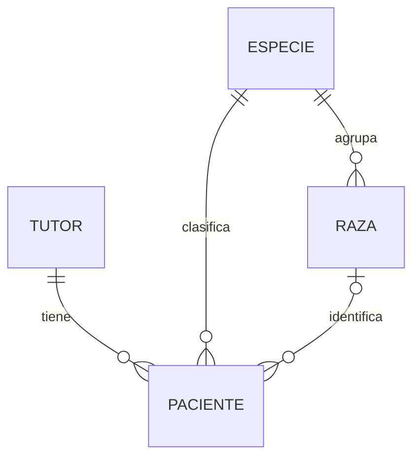
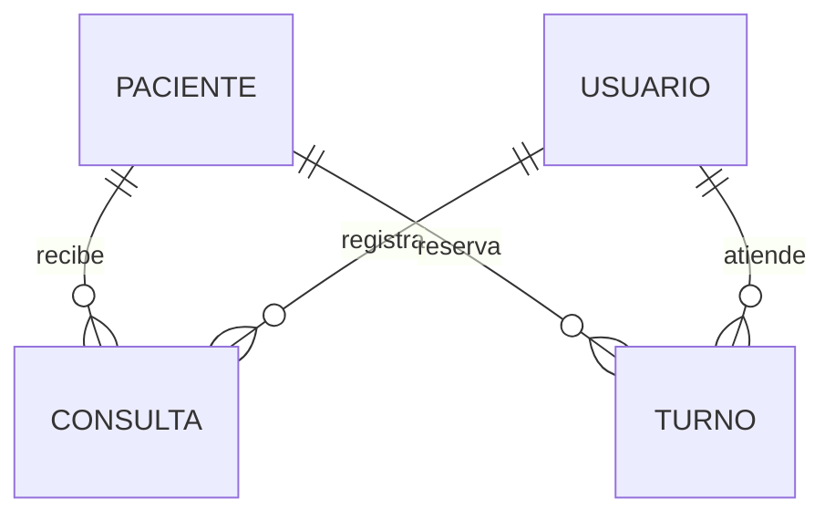
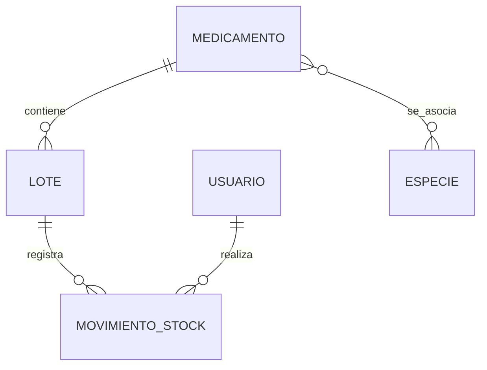

# Modelo de datos del frontend · Veterinaria Cariñositos

[Volver al README](../README.md)

Este documento explica los tipos de datos que usa Next.js, las relaciones que representa y el intercambio con Django. **El frontend no crea otra base de datos**: recibe y envía JSON; el modelo relacional se conserva en PostgreSQL a través del backend.

Los tipos TypeScript ayudan a desarrollar, pero no validan por sí solos una respuesta HTTP en tiempo de ejecución. Zod valida las entradas donde se aplica; Django vuelve a validar las reglas de negocio.

<a id="indice"></a>

## Índice

- [Capas del modelo](#capas-del-modelo)
- [Entidades y contratos principales](#entidades-y-contratos-principales)
- [Relaciones que muestra la interfaz](#relaciones-que-muestra-la-interfaz)
- [IDs, datos anidados y catálogos](#ids-datos-anidados-y-catalogos)
- [Listados paginados](#listados-paginados)
- [Fechas, nulos y estados](#fechas-nulos-y-estados)
- [Formularios y validación](#formularios-y-validacion)
- [Estado global y almacenamiento](#estado-global-y-almacenamiento)
- [Dónde se transforma cada dato](#donde-se-transforma-cada-dato)

[↑ Volver al índice](#indice)

<a id="capas-del-modelo"></a>

## Capas del modelo

| Capa | Representación | Función |
| --- | --- | --- |
| Formulario | `TutorFormValues`, `PacienteFormValues`, `TurnoFormValues` y valores de inventario | Campos que escribe o selecciona el usuario. |
| Petición HTTP | Payload JSON | Datos convertidos a los tipos que espera la API. |
| Respuesta HTTP | Tipos como `Paciente`, `Turno` o respuesta paginada | Datos devueltos por Django. |
| Interfaz | Props y estado React | Selecciones, mensajes, estado de envío y tema. |
| Persistencia | Modelos Django y PostgreSQL | Datos permanentes, relaciones y restricciones. |

Los nombres locales pueden variar entre páginas: `PacienteOpcion` contiene menos información que la ficha `Paciente`. Eso no crea entidades distintas en la base.

[↑ Volver al índice](#indice)

<a id="entidades-y-contratos-principales"></a>

## Entidades y contratos principales

| Entidad | Datos que usa la interfaz | Relación representada |
| --- | --- | --- |
| Usuario actual | `id`, `username`, `rol`; otros campos según serializer | Identidad y acciones habilitadas. |
| Tutor | `id`, nombre, apellido, DNI, teléfono, email, dirección, observaciones, activo | Responsable de varios pacientes. |
| Especie | `id`, nombre y activo según contexto | Clasifica pacientes y agrupa razas. |
| Raza | `id`, nombre, `especie`, especie_nombre y activo según respuesta | Pertenece a una especie. |
| Paciente | `id`, nombre, especie, raza, sexo, nacimiento, castración, color, microchip, observaciones, activo | Tutor, especie y raza opcional. |
| Consulta | `id`, fecha, motivo, síntomas, diagnóstico, tratamiento, peso, observaciones, veterinario_nombre | Historia clínica del paciente. |
| Turno | `id`, paciente, paciente_nombre, veterinario, veterinario_nombre, inicio, fin, motivo, observaciones, estado | Reserva para un paciente con un profesional. |
| Medicamento | Identificador, nombre, laboratorio, principio activo, concentración, presentación, contenido/unidad, vía, especies, mínimo y stock utilizable | Catálogo y asociaciones con especies. |
| Lote | Identificador, medicamento, número, vencimiento, cantidad_actual, observaciones y activo | Partida de un medicamento. |
| MovimientoStock | Identificador, lote, tipo, cantidad, saldo anterior/posterior, motivo, observaciones y responsable | Registro de cambios de un lote. |
| Internacion y EvolucionInternacion | Contratos disponibles en la API del backend | La existencia de modelos/endpoints no acredita pantallas frontend terminadas. |

Este documento recoge los campos relevantes para la interfaz; el listado completo y obligatorio de cada respuesta se consulta en `/api/docs/` del backend.

[↑ Volver al índice](#indice)

<a id="relaciones-que-muestra-la-interfaz"></a>

## Relaciones que muestra la interfaz

### Tutores y pacientes



La ficha del tutor lista sus pacientes. La ficha del paciente permite volver al tutor. El formulario filtra razas mediante `raza.especie === Number(especieSeleccionada)` y borra la raza al cambiar de especie. Django verifica también que la relación sea válida.

### Atención y reservas



El historial clínico muestra consultas; el calendario muestra turnos. Un turno atendido y una consulta clínica no son automáticamente el mismo registro: son recursos diferentes.

### Inventario



La ficha del medicamento muestra lotes. El formulario de movimiento opera sobre un lote concreto. Los retiros de inventario no representan por sí solos una administración clínica de dosis a un paciente.

[↑ Volver al índice](#indice)

<a id="ids-datos-anidados-y-catalogos"></a>

## IDs, datos anidados y catálogos

En las escrituras se envían identificadores; en las lecturas, Django puede agregar datos de presentación.

Ejemplo simplificado de lectura de un paciente:

```json
{
  "id": 5,
  "nombre": "Luna",
  "especie": 2,
  "raza": null,
  "tutor_detalle": {
    "id": 2,
    "nombre": "María",
    "apellido": "Gómez"
  },
  "especie_detalle": {
    "id": 2,
    "nombre": "Felino"
  },
  "raza_detalle": null
}
```

Es un ejemplo parcial, no un payload completo de alta. `tutor_detalle`, `especie_detalle` y `raza_detalle` se usan para mostrar nombres sin repetir consultas por cada fila.

En los listados de inventario, `especies_detalle` y `medicamento_detalle` agregan información relacionada. Su disponibilidad depende del serializer que selecciona el backend para la acción; no asumir que un campo exclusivo de `list` existe en `retrieve`.

Los selectores HTML trabajan con strings. Las funciones de payload convierten IDs a números y valores vacíos a `null` cuando el contrato lo requiere. Los valores decimales pueden mantenerse como strings para enviarlos sin perder precisión.

[↑ Volver al índice](#indice)

<a id="listados-paginados"></a>

## Listados paginados

```ts
type PaginatedResponse<T> = {
  count: number;
  next: string | null;
  previous: string | null;
  results: T[];
};
```

Este tipo es una representación documental del contrato común, no una afirmación de que exista centralizado en un archivo del proyecto.

Para listar se recorre `data.results`, no `data`. Cuando un selector necesita todos los catálogos, `djangoGetAll` recorre páginas y devuelve un array. Las pantallas conservan búsqueda, filtros y página en la URL.

Ejemplos de filtros usados:

- Tutores: `search`, `page`.
- Pacientes: `search`, `especie`, `activo`, `page`.
- Turnos: búsqueda y estado; calendario por `mes`.
- Historial de stock: lote, tipo y búsqueda.
- Alertas: vista y días hasta el vencimiento según la página.

[↑ Volver al índice](#indice)

<a id="fechas-nulos-y-estados"></a>

## Fechas, nulos y estados

| Dato | Representación | Tratamiento |
| --- | --- | --- |
| Nacimiento y vencimiento | `YYYY-MM-DD` | Fecha de calendario; evitar conversiones que desplacen el día por zona horaria. |
| Inicio y fin de turno | ISO con offset | Mostrar en `America/Argentina/Buenos_Aires`. |
| Campos de agenda | `datetime-local` | No incluyen zona; convertir según el contrato de la clínica antes de enviarlos. |
| Raza y microchip sin informar | `null` en la API según campo | Mostrar “Sin registrar” y normalizar al escribir. |
| Peso u otros decimales DRF | Frecuentemente string o null | Convertir para presentación; respetar el contrato al guardar. |
| Estado de turno | `PENDIENTE`, `CONFIRMADO`, `ATENDIDO`, `CANCELADO` | Etiquetas, colores y acciones según estado y rol. |
| Estado activo | boolean | Baja lógica y restricciones operativas. |

El frontend no debe inventar transiciones válidas: Django controla los cambios y la disponibilidad. La fecha actual y los datos de sesión se calculan en el contexto dinámico apropiado, como se hizo con `connection()` y `Suspense` en las pantallas revisadas.

[↑ Volver al índice](#indice)

<a id="formularios-y-validacion"></a>

## Formularios y validación

### Paciente

`PacienteFormValues` mantiene campos de formulario. `pacienteSchema` valida entradas y `pacientePayload` convierte los datos para la API. La alta se realiza desde un tutor; editar no debe reemplazar ese tutor por el ID del paciente ni activar el registro por defecto.

### Turno

`TurnoFormValues` contiene paciente, veterinario, inicio, fin, motivo y observaciones. `turnoSchema` valida la forma de los datos. El servidor verifica fecha futura cuando corresponde, duración válida y conflictos de agenda. El estado y el creador se asignan o modifican mediante operaciones autorizadas del backend.

### Inventario

El formulario de medicamento separa contenido neto, unidad y stock mínimo. Crear un lote no agrega stock: comienza con cero. Los movimientos llevan lote, tipo, cantidad, motivo y observaciones; los saldos y responsable se calculan en Django.

`INGRESO` y `AJUSTE_ENTRADA` suman; `RETIRO` y `AJUSTE_SALIDA` restan. Cuando el lote está vencido o no disponible, el flujo trabajado limita la operación a ajuste de salida. El saldo estimado del formulario es orientativo: la transacción del servidor decide el saldo final.

[↑ Volver al índice](#indice)

<a id="estado-global-y-almacenamiento"></a>

## Estado global y almacenamiento

| Información | Ubicación | Persistencia |
| --- | --- | --- |
| Tema | `ThemeContext` y clase `dark` del HTML | Preferencia en localStorage. |
| Campos y errores de formulario | React Hook Form y estado del componente | Temporal. |
| Filtros y página | Query string | Compartible mediante URL. |
| Tokens de autenticación | Cookies HttpOnly configuradas por servidor | Según duración y configuración de las cookies. |
| Pacientes, consultas y stock | PostgreSQL del backend | Persistencia de negocio. |

El contexto del tema no guarda tokens, contraseñas ni una copia global de toda la base de datos.

[↑ Volver al índice](#indice)

<a id="donde-se-transforma-cada-dato"></a>

## Dónde se transforma cada dato

| Archivo o área | Responsabilidad |
| --- | --- |
| `src/lib/django.ts` | Lectura autenticada de respuestas de Django. |
| `src/lib/django-list.ts` | Unión de páginas de catálogos. |
| `src/lib/*-schema.ts` | Validación y conversión de valores del formulario. |
| `src/app/api/` | Intermediación de mutaciones y lectura de cookies. |
| `src/app/(crm)/**/page.tsx` | Consulta y composición de datos para la pantalla. |
| `src/components/` | Representación e interacción. |
| `src/context/ThemeContext.tsx` | Preferencia global del tema. |

Para contrastar contratos: abrir Swagger, revisar el serializer de Django y comparar con el tipo TypeScript de la pantalla. Agregar un campo a un tipo no hace que el backend lo devuelva; un cast `as T` tampoco valida la respuesta.
